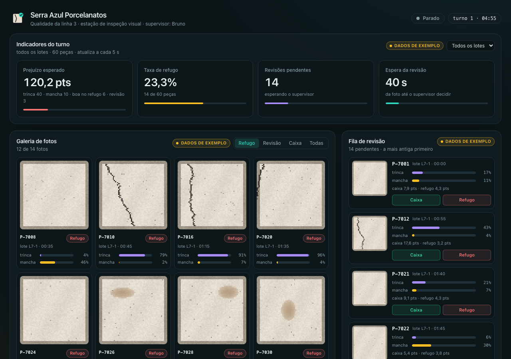

# Painel de qualidade — Serra Azul Porcelanatos

> **Situação real do webforge.** Na linha de esmaltação, uma câmera fotografa
> cada peça e uma IA estima a chance de trinca e de mancha. A API da estação já
> decide o destino (caixa, refugo ou revisão do supervisor) e a linha roda dentro
> dela. O supervisor de qualidade ganhou um painel — bonito, mas de mentira: tudo
> nele são dados de exemplo. Sua missão é **ligar o painel à API**: a galeria de
> fotos, os indicadores com gráfico e filtros, a revisão ao vivo por WebSocket e
> um painel que abre mesmo quando a rede da fábrica cai.



## Como rodar

Requisitos: **Node 22.13 ou mais novo** (recomendado o 24, veja `.nvmrc`).

```bash
npm install
npm run dev          # API em :3001 e painel em http://localhost:5173
```

Outros comandos (na raiz):

```bash
npm run typecheck    # tipos da API, do painel e do contrato
npm test             # testes (Vitest)
npm start            # compila o painel e sobe a API servindo tudo em :3001
```

## As etapas

Cada etapa vale XP na plataforma e só abre depois da anterior. Antes de enviar,
rode a **central da qualidade** — as mesmas checagens da plataforma, com um
navegador de verdade:

```bash
npx playwright install chromium   # uma vez só
npm run central -- 1              # (2, 3 ou 4)
```

| Etapa | O que fazer | Onde |
|---|---|---|
| **1. Galeria de fotos** | A rota da **miniatura** (24 × 24, com cache para sempre); `obter()` e `buscarFotos()`; o `useGaleria` busca a página 1, filtra por destino (abas), "Carregar mais" junta a página seguinte e o erro da API mostra "Tentar de novo" | `apps/api/src/routes/fotos.ts`, `apps/web/src/services/api.ts`, `apps/web/src/hooks/useGaleria.ts` |
| **2. Indicadores e gráfico** | `GET /api/series` na API (validando `agrupar` e `lote`); `buscarSeries()`, `useMetricas` e `useSeries` no painel, buscando de novo quando o filtro de lote ou o agrupamento mudam | `apps/api/src/routes/series.ts`, `services/api.ts`, `hooks/useMetricas.ts`, `hooks/useSeries.ts` |
| **3. Revisão ao vivo** | O **WebSocket** `/api/ao-vivo` nos dois sentidos: a API empurra cada foto nova e cada revisão; o supervisor revisa pelo painel e **todos** os painéis abertos atualizam — sem polling | `apps/api/src/routes/aoVivo.ts`, `services/api.ts`, `hooks/useAoVivo.ts`, `hooks/useFila.ts` |
| **4. PWA e fim dos mocks** | O painel vira um **PWA**: manifest com ícones, service worker e abre **sem rede** com os últimos dados (e um aviso de offline). Nenhum hook importa `mocks/`; tipos e testes passando | `apps/web/index.html`, `apps/web/public/sw.js`, `apps/web/src/main.tsx`, `apps/web/src/hooks/` |

Os pontos a implementar estão marcados com `TODO Etapa N`. Os componentes já
sabem mostrar carregando, erro, dados e o aviso de offline — você não precisa
mexer neles.

Leia [`docs/arquitetura.md`](docs/arquitetura.md) e [`docs/contrato.md`](docs/contrato.md).

## Como enviar

1. Este repositório precisa ser **público** no seu GitHub.
2. Faça commit e push.
3. Na plataforma (Situações reais → Inspeção visual: o painel de qualidade),
   cole a URL e clique em **Validar**. A central roda `npm start` e abre o
   painel num navegador.
